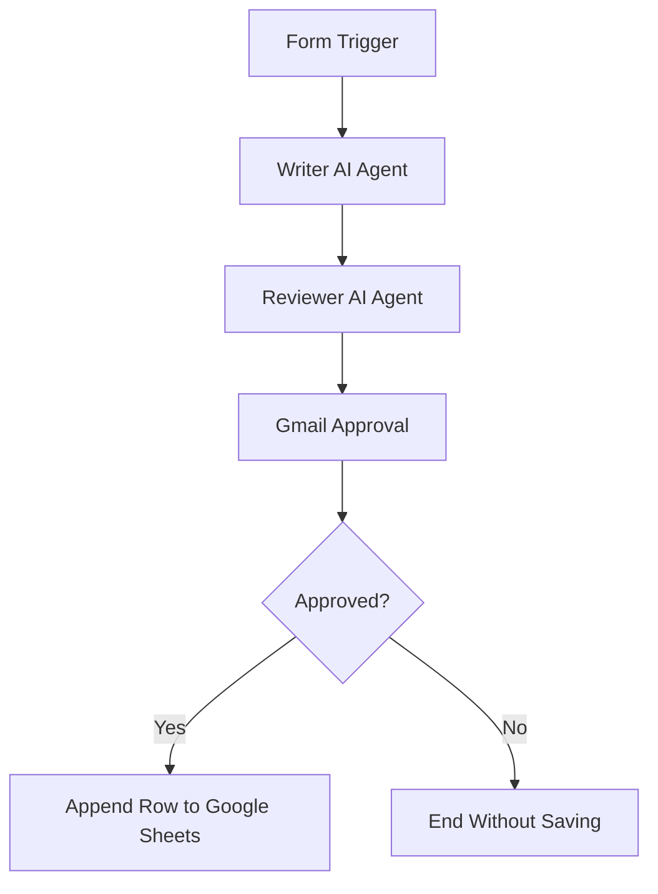

# LinkedIn Post Approval Workflow — n8n

An AI-powered LinkedIn post generation and approval workflow built using **n8n**, AI Agents, Gmail, and Google Sheets.

## 📌 Project Overview

This workflow automates LinkedIn post creation using two AI Agents. The Writer Agent drafts a post based on a user-provided topic, and the Reviewer Agent improves the draft. The final post is then emailed for human approval. Only approved posts are saved to Google Sheets.

## ✨ Features

- **Form Trigger:** Collects a topic through an n8n form.
- **Writer AI Agent:** Generates a LinkedIn post with a strong opening hook, 120–150 words, one call to action, and up to three hashtags.
- **Reviewer AI Agent:** Scores the post on hook, clarity, and call to action, then improves its weakest part.
- **Gmail Approval:** Emails the reviewed post with Approve and Decline options.
- **Human-in-the-loop approval:** Pauses the workflow until a decision is made, with a one-day wait limit.
- **Conditional routing:** Uses an IF node to check the approval decision.
- **Google Sheets Integration:** Saves approved posts with their date, topic, final content, and status.

## 🛠️ Tools and Technologies

- n8n Cloud
- AI Agent nodes and compatible chat models
- Gmail
- Google Sheets
- Google OAuth credentials

## 🔄 Workflow Architecture

1. **Form Trigger:** The user submits a LinkedIn post topic.
2. **Writer AI Agent:** Drafts the post.
3. **Reviewer AI Agent:** Reviews and improves the draft.
4. **Gmail Approval:** Sends the final post to the user and waits for a decision.
5. **IF Node:** Checks whether the post was approved.
6. **Google Sheets:** Appends a row only on the approved branch.

### Workflow Diagram

## 📊 Google Sheets Structure

The spreadsheet contains these columns:

| Column | Description |
|---|---|
| Date | Date and time of the workflow run |
| Topic | Topic submitted through the form |
| Final Post | Final reviewed LinkedIn post |
| Status | Approval status, such as Approved |

## ⚙️ Setup Instructions

1. Create a workflow in n8n Cloud.
2. Add and configure the Form Trigger with one required text field named `Topic`.
3. Add the Writer AI Agent and connect a compatible chat model.
4. Add the Reviewer AI Agent and connect its chat model.
5. Add a Gmail node using **Send message and wait for response** with the Approval response type.
6. Set the wait limit to one day.
7. Add an IF node to check the approval result.
8. Create a Google Sheet with the four required column headers.
9. Configure Google Sheets to append a row on the IF node's True branch.
10. Save the workflow as **LinkedIn Post Approval** and test both approval outcomes.

## 🔐 Credentials and Security

- Store Gmail and Google Sheets credentials in n8n's credential manager.
- Configure AI model credentials securely.
- Do not commit API keys, OAuth secrets, access tokens, or private credentials to GitHub.
- Use your own authorized accounts and test the workflow before production use.

## 🧪 Testing

Test
